# DINO-WM vs. ACWM-DiT-S on ACWM-Phys

> Branch `hanbin5/acwm-baseline` compares DINO-WM with ACWM-DiT-S, the baseline model of the ACWM-Phys paper, on four environments: Stack Cube, Push Sand, Cloth Move and Pour Water. Both models get the first frame and the actions and predict the following frames. Both are scored on the same test windows and the same frames.

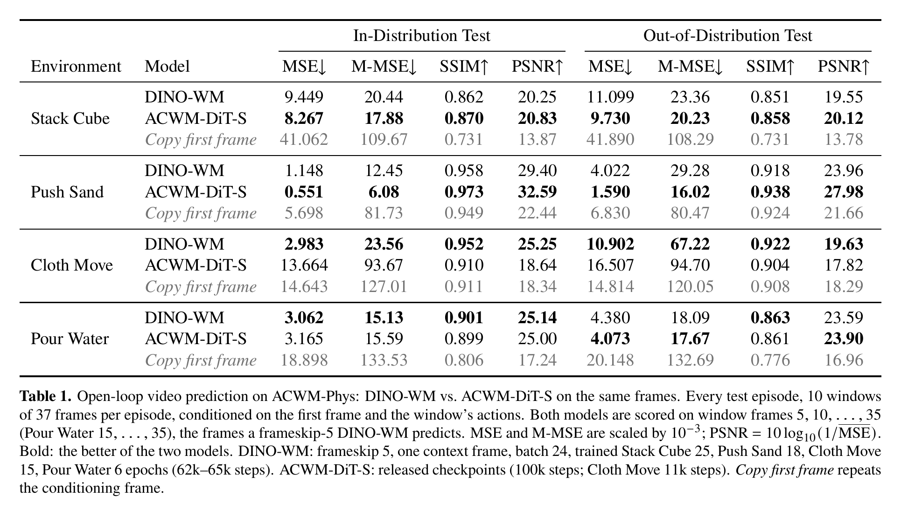

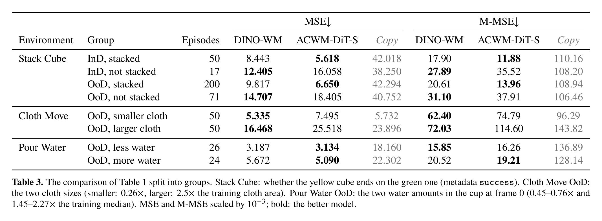

- ACWM-DiT-S is better on Push Sand (MSE ×10⁻³ 0.55 vs. 1.15 InD, 1.59 vs. 4.02 OoD) and on Stack Cube episodes where the cube ends stacked. DINO-WM is better on Stack Cube episodes where the stack fails (OoD 14.7 vs. 18.4) and on Cloth Move. The released Cloth Move checkpoint of ACWM-DiT-S stopped at 11k training steps. On Pour Water the 95 % intervals of the two models overlap in InD and in OoD.
- The metrics are those of the ACWM-Phys paper (MSE, masked MSE, SSIM, PSNR). They are computed on window frames 5, 10, ..., 35 (Pour Water 15, ..., 35), the frames a frameskip-5 DINO-WM predicts. The paper averages over all 37 frames of a window.
- With the official evaluation the released checkpoints reproduce the paper's MSE within 2 % when only the first 50 test episodes are scored, as `scripts/eval_all.sh` does. These 50 are the first entries of `metadata.pt`. For Stack Cube they are all successful stacks, and for Cloth Move OoD they are all smaller cloths. On all test episodes the Stack Cube MSE is 43 % (InD) and 32 % (OoD) higher and the Cloth Move OoD MSE is 2.2 times higher.
- DINO-WM in these tables is the model of the experiment below (62k–65k optimizer steps). A longer run with the training budget of ACWM-DiT-S (933,334 steps at batch 24) was started and stopped. Plan, budget and checkpoints: [issue #4](https://github.com/jongmin-s-multicore/thread0/issues/4).
- Code: ACWM-DiT-S evaluation in [repro/acwm_dit/](repro/acwm_dit/README.md). DINO-WM training on cached DINOv2 features in `repro/colab/acwm_long.py`.

---

# DINO-WM on ACWM-Phys physics videos

> This experiment comes from branch `hanbin5/acwm-phys`, which this branch builds on. We train the DINO-WM world model on four physics environments of the ACWM-Phys benchmark: Pour Water (fluid), Cloth Move (cloth), Push Sand (granular material) and Stack Cube (rigid pick-and-stack). We measure how well the model predicts future frames from the first frame and the actions, inside and outside the training distribution.

<table>
<tr>
<td align="center"><b>Pour Water</b><br>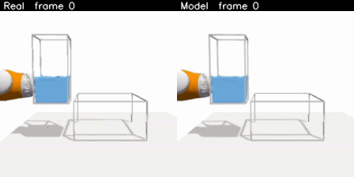</td>
<td align="center"><b>Cloth Move</b><br>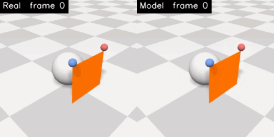</td>
</tr>
<tr>
<td align="center"><b>Push Sand</b><br>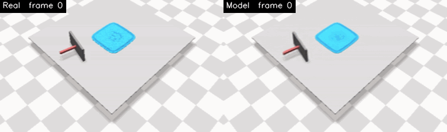</td>
<td align="center"><b>Stack Cube</b><br>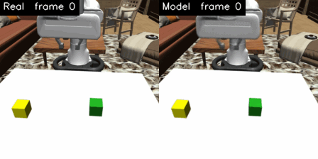</td>
</tr>
</table>

In every clip the left half is the real video and the right half is the model. The model half is the world model's prediction of the whole episode from the first frame and the actions, decoded to pixels. These four clips are typical in-distribution test episodes.

- Videos, real next to model: [Pour Water](https://drive.google.com/drive/folders/1ejhY8cU0dFgsPEEExnReXy0_kTZ1yRkg) · [Cloth Move](https://drive.google.com/drive/folders/1zackVOkDErFJBOC7ylLhR44QV_rfAZkC) · [Push Sand](https://drive.google.com/drive/folders/1jPap3D5vxFnut8BHrOugjFDgN9xxZkIy) · [Stack Cube](https://drive.google.com/drive/folders/1r2SIYP-alTeVXvKPwAqPim6WAvd6t6IL) (Google Drive)
- Results: [summary](#summary) and [tables](#acwm-phys-results) below
- Follow-up: [does more training fix it?](#more-training) No, not with 8 times the optimizer steps.
- How to run: [Reproduce the ACWM-Phys experiments](#reproduce-the-acwm-phys-experiments)
- Settings and data conventions (Korean): [repro/SETTINGS.md](repro/SETTINGS.md) §7 (Pour Water) and §8 (the other three)
- Prior work on DINO-WM, physics and InD/OoD evaluation (Korean): [repro/PRIOR_WORK.md](repro/PRIOR_WORK.md)

The repository of this branch reproduces the planning benchmarks of the DINO-WM paper. The reproduction part is unchanged on this branch and starts at [thread0: DINO-WM reproduction](#thread0-dino-wm-reproduction) further down.

## Summary

[ACWM-Phys](https://arxiv.org/abs/2605.08567) (Hugging Face dataset [`t1an/ACWM-Phys`](https://huggingface.co/datasets/t1an/ACWM-Phys)) is a benchmark of simulated physics videos with per-frame actions. Every environment has a training set, an in-distribution (InD) test set and an out-of-distribution (OoD) test set. ACWM-Phys is not part of the DINO-WM paper. We trained DINO-WM on four of its environments. The model consists of frozen DINOv2 ViT-S/14 features, a ViT predictor and a VQ-VAE decoder. It is trained from scratch on each environment. We measured how well the world model predicts future frames from the first frame and the actions. There is no planning, because the dataset has no simulator, goals or rewards.

- In distribution the model predicts well and follows the actions. Its one-step error in DINOv2 feature space is 0.17–0.46 of the error of copying the previous frame. With another episode's actions the rollout is 1.7–3.1× worse. Averaged over an episode, the gripper and pusher positions in the rollout are 3–6 px from the real positions (224 px frames), while they move 30–38 px.
- Out of distribution, the amount of material in the rollout moves toward the amount seen in training. A cloth 2.5× larger than the training cloth shrinks to the training size within one episode. In the last frame the real cloth covers 4,475 pixels and the model's cloth covers 1,836. On InD episodes the model's cloth covers 1,888. A smaller cloth grows (real 404, model 1,129). A sand pile with twice the particles shrinks to the training size (real 3,886, model 1,843). The poured water ends near the training mean regardless of the real amount.
- In the rollout, rare outcomes shift toward the common outcome. In Stack Cube, 27 % of the training episodes are failed stacks. On failed test episodes the model's last frame shows a stacked cube in 23–24 % of the episodes. The real last frame shows a stacked cube in 8–12 %.
- The decoder is not the cause. The decoder draws the OoD sizes and the failed stacks when it is given the features of the real frames (last column of the second table). The difference is in the predicted features.

Clips from outside the training distribution, with the real video on the left and the model on the right:

<table>
<tr>
<td align="center"><b>Cloth 2.5× larger</b>: the model shrinks it to the training size<br>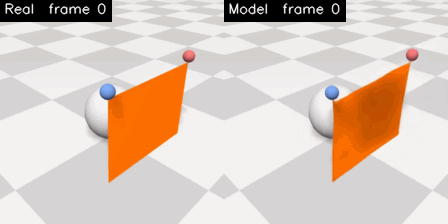</td>
<td align="center"><b>Cloth 0.26× the area</b>: the model grows it<br>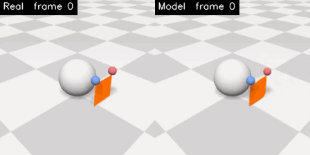</td>
</tr>
<tr>
<td align="center"><b>Twice the sand</b>: the pile shrinks to the training size<br>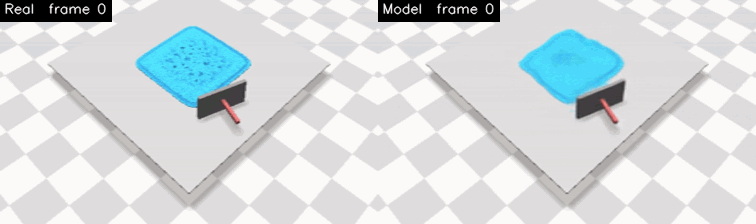</td>
<td align="center"><b>Less water</b>: the box fills as much as in training<br>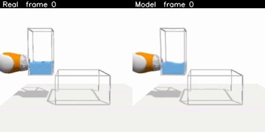</td>
</tr>
<tr>
<td align="center" colspan="2"><b>A failed stack</b>: the real arm loses the cube, the model stacks it<br>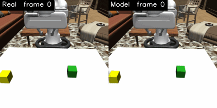</td>
</tr>
</table>

The cloth and sand clips each show an episode near the median error of its test group. The water clip shows the episode with the median amount of water of its group. The Stack Cube clip was picked to show the effect. The model ends with a stacked cube in 23 % of the failed OoD episodes.

## Environments, videos and result files

| Environment (video folder) | What happens | OoD test set | Episodes: train / val · InD test · OoD test | Training |
|---|---|---|---|---|
| [`[acwm] pour_water`](https://drive.google.com/drive/folders/1ejhY8cU0dFgsPEEExnReXy0_kTZ1yRkg) | A cup is tilted and pours water into a box (300 frames) | less or more water: 26 low, 24 high | 882 / 98 · 50 · 50 | num_hist 1 (B) and 3 (A), 6 epochs |
| [`[acwm] cloth_move`](https://drive.google.com/drive/folders/1zackVOkDErFJBOC7ylLhR44QV_rfAZkC) | Two grippers hold two corners of a cloth and drape it over a sphere (65 frames) | cloth area 0.26× (50 episodes) or 2.5× (50). Training has one cloth size | 1800 / 200 · 100 · 100 | num_hist 1, 15 epochs |
| [`[acwm] push_sand`](https://drive.google.com/drive/folders/1jPap3D5vxFnut8BHrOugjFDgN9xxZkIy) | A board pushes a pile of particles three times (64 frames) | about twice the particles | 1605 / 179 · 100 · 100 | num_hist 1, 18 epochs |
| [`[acwm] stack_cube`](https://drive.google.com/drive/folders/1r2SIYP-alTeVXvKPwAqPim6WAvd6t6IL) | A Franka arm picks the yellow cube and stacks it on the green one (53–58 frames). The stack fails in 27 % of the training episodes | yellow cube starts outside the training region | 1235 / 138 · 67 · 271 | num_hist 1, 25 epochs |

All models use 224 px input, frameskip 5, predictor learning rate 5e-5 and batch 24. With this frameskip the model predicts every 5th frame. With the epoch counts in the table, every run has about 62–65k optimizer steps. The data conventions, the settings and the evaluation protocol are in [SETTINGS.md §7](repro/SETTINGS.md) (Pour Water) and [§8](repro/SETTINGS.md) (the other three), in Korean. The data conventions cover which action drives which frame and the Push Sand action encoding.

Each video folder also contains the numbers used in the tables below: `<env>_h1f5.json` (prediction metrics with bootstrap intervals), `<env>_h1f5_quant.json` (physical quantities), `epoch_logs.jsonl` (training curves) and figures. For [Cloth Move](https://drive.google.com/drive/folders/1Kr9HsFg_bmx7FZVMZQNSJRP6MPPDpAB0), [Push Sand](https://drive.google.com/drive/folders/16OXSzpN5lt7vD6LExBdFSZ1D3B48mP_E) and [Stack Cube](https://drive.google.com/drive/folders/1KSYUBFMk1HCRz-X8LrMkkN6ssosXx8bx) these files are in the `results/` sub-folder. For Pour Water they are next to the videos. Model weights are not uploaded.

## ACWM-Phys results

Prediction quality of the num_hist 1 models. *Copy* predicts that nothing changes. *Decoder ceiling* is the real target frame passed through the encoder and decoder. It is the best result the decoder can produce. *Skill* is the share of the gap between copying (through the decoder) and the decoder ceiling that the model closes. A skill of 0 equals copying and a skill of 1 equals the decoder ceiling. Rollouts are open loop over 37-frame windows (7 predicted frames at frameskip 5), with 10 windows per episode. For LPIPS, lower is better.

| Environment | Test set | Episodes | One-step latent error, model ÷ copy | Rollout LPIPS: model / copy-last / decoder ceiling | Skill [95 % CI] | LPIPS with another episode's actions ÷ true actions |
|---|---|---|---|---|---|---|
| Pour Water ¹ | InD test | 50 | 0.46 | 0.090 / 0.167 / 0.072 | 0.84 [0.83, 0.84] | 1.7× |
| Pour Water ¹ | OoD low volume | 26 | 0.47 | 0.085 / 0.160 / 0.065 | 0.81 [0.80, 0.82] | 1.7× |
| Pour Water ¹ | OoD high volume | 24 | 0.59 | 0.182 / 0.215 / 0.153 | 0.74 [0.73, 0.75] | 1.3× |
| Cloth Move | InD test | 100 | 0.31 | 0.038 / 0.113 / 0.018 | 0.79 [0.78, 0.81] | 3.1× |
| Cloth Move | OoD smaller cloth | 50 | 0.74 | 0.050 / 0.059 / 0.012 | 0.22 [0.17, 0.27] | 1.5× |
| Cloth Move | OoD larger cloth | 50 | 0.77 | 0.125 / 0.167 / 0.040 | 0.35 [0.31, 0.38] | 1.5× |
| Push Sand | InD test | 100 | 0.39 | 0.025 / 0.054 / 0.018 | 0.83 [0.82, 0.84] | 2.7× |
| Push Sand | OoD 2× particles | 100 | 0.74 | 0.069 / 0.065 / 0.042 | 0.31 [0.28, 0.33] | 1.4× |
| Stack Cube | InD test | 67 | 0.17 | 0.069 / 0.225 / 0.024 | 0.79 [0.76, 0.81] | 2.1× |
| Stack Cube | OoD start position | 271 | 0.18 | 0.078 / 0.228 / 0.027 | 0.76 [0.74, 0.77] | 1.9× |

¹ The Pour Water rollout columns use window frames 15–35, so that its two models are compared on the same frames. The other environments use all predicted frames (5–35). All Pour Water episodes begin with the same tilt. For windows that start at frame 200 or later the last column is 1.9× / 1.9× / 1.5×.

Physical quantities in the rollout, measured with the same colour mask on real and decoded frames (224 px). The rollout starts from the first frame and uses all actions of the episode.

| Environment | Test set | Quantity | Real | Model | Decoder on real frames |
|---|---|---|---|---|---|
| Pour Water | InD test | water pixels in the box, frames ≥ 250 | 1,970 | 2,045 | 1,962 |
| Pour Water | OoD low volume | water pixels in the box, frames ≥ 250 | 1,384 | 2,049 | 1,370 |
| Pour Water | OoD high volume | water pixels in the box, frames ≥ 250 | 2,407 | 2,077 | 2,326 |
| Cloth Move | InD test | cloth pixels, last frame | 1,819 | 1,888 | 1,790 |
| Cloth Move | OoD smaller cloth | cloth pixels, last frame | 404 | 1,129 | 388 |
| Cloth Move | OoD larger cloth | cloth pixels, last frame | 4,475 | 1,836 | 4,352 |
| Push Sand | InD test | sand pixels, last frame | 1,792 | 1,665 | 1,729 |
| Push Sand | OoD 2× particles | sand pixels, last frame | 3,886 | 1,843 | 3,215 |
| Stack Cube | InD test, successful stacks (50) | last frame shows the cube stacked | 100 % | 96 % | 100 % |
| Stack Cube | InD test, failed stacks (17) | last frame shows the cube stacked | 12 % | 24 % | 18 % |
| Stack Cube | OoD, successful stacks (200) | last frame shows the cube stacked | 100 % | 90 % | 100 % |
| Stack Cube | OoD, failed stacks (71) | last frame shows the cube stacked | 8 % | 23 % | 6 % |

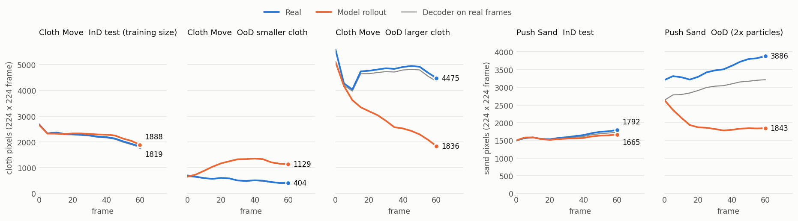

Area of the cloth and of the sand over the episode, averaged over each test group. Blue is the real video, orange is the model's rollout and grey is the decoder on the real frames.

Limits of these numbers:
- There is one seed and one setting per environment. Pour Water has two models (num_hist 3 and 1), and they did not differ at equal horizon. The validation loss was still falling at the last epoch (0.4–1.8 % per epoch).
- The tables do not compare with the ACWM-DiT numbers of the ACWM-Phys paper, because we score every 5th frame at 224 px and the released test sets differ in size from the test sets in the paper.
- The colour masks are checked against the decoder on real frames. On InD episodes the masks overlap with IoU 0.92 (cloth) and 0.95 (sand), and the areas agree within 2–3 %. For Push Sand OoD the decoder draws 17 % less sand than the real frame. Part of the gap in that row is due to the decoder.
- The "stacked" test is an image rule. It tests whether the yellow cube's centre is directly above the green cube. On real frames the rule agrees with the dataset's success flag in 98.8 % of the training episodes. Failed stacks show 8–12 % in the Real column because the rule and the flag do not agree in every episode.

## More training

More training does not fix the out-of-distribution cases. We continued the three num_hist 1 models (Cloth Move, Push Sand, Stack Cube) to 2, 4 and 8 times the original number of optimizer steps. The data, the batch size, the learning rates and the loss are the same as in the original runs. Only the predictor and the action encoder are trained further, because the encoder is frozen and the decoder never sees the predictor: the encoder's features of all frames are computed once and kept on the GPU, and the decoder of the original run is used unchanged.

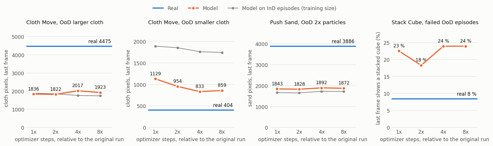

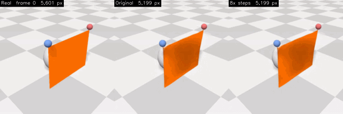

The clip is a Cloth Move episode with the larger cloth: the real video, the original model and the model trained 8 times longer. The label gives the cloth pixels of each frame.

| Last frame | Real | Original | 2× steps | 4× steps | 8× steps |
|---|---|---|---|---|---|
| Cloth Move, OoD larger cloth: cloth pixels | 4,475 | 1,836 | 1,822 | 2,017 | 1,923 |
| Cloth Move, OoD smaller cloth: cloth pixels | 404 | 1,129 | 954 | 833 | 859 |
| Cloth Move, InD test: cloth pixels | 1,819 | 1,888 | 1,852 | 1,759 | 1,742 |
| Push Sand, OoD 2× particles: sand pixels | 3,886 | 1,843 | 1,828 | 1,892 | 1,872 |
| Push Sand, InD test: sand pixels | 1,792 | 1,665 | 1,651 | 1,728 | 1,720 |
| Stack Cube, OoD failed stacks (71): shows the cube stacked | 8 % | 23 % | 18 % | 24 % | 24 % |
| Stack Cube, OoD successful stacks (200): shows the cube stacked | 100 % | 90 % | 88 % | 94 % | 94 % |
| Stack Cube, InD failed stacks (17): shows the cube stacked | 12 % | 24 % | 29 % | 29 % | 41 % |

| Validation loss (latent MSE, one step) | Original | 2× steps | 4× steps | 8× steps |
|---|---|---|---|---|
| Cloth Move | 0.166 | 0.155 | 0.151 | 0.150 |
| Push Sand | 0.172 | 0.162 | 0.158 | 0.155 |
| Stack Cube | 0.329 | 0.295 | 0.271 | 0.257 |

- The larger cloth and the doubled sand pile stay at the training size at every amount of training.
- The smaller cloth moves a little towards the real size (1,129 to 859 pixels) and is still twice the real size (404).
- Failed stacks are still shown as stacked about three times as often as they really are. On the 17 failed InD episodes the share rises from 24 % to 41 %.
- In-distribution prediction keeps improving: the validation loss falls in all three environments, and successful stacks are predicted more often (90 % to 94 %).
- Cloth Move starts to overfit. At 8 times the steps its training loss is 0.100 and its validation loss stays at 0.150.

Videos (real, original model, 8× model side by side, ten episodes per group) and the numbers are in [`[acwm-more train] cloth_move`](https://drive.google.com/drive/folders/1m5OJtnoPXLohEzEPHtQsI9KnQJL_4P61), [`[acwm-more train] push_sand`](https://drive.google.com/drive/folders/1SLErnd0E6CFM00rarQrZp00Z9DGNzp83) and [`[acwm-more train] stack_cube`](https://drive.google.com/drive/folders/1FrMpiW1B3STGARi19XV-w_q81lfk1j80). There is one run per environment.

## How to read the ACWM-Phys videos

- The left panel, Real, is the dataset video. The right panel, Model, is the world model's rollout from the first frame and all actions of the episode, decoded to pixels. Both panels show every 5th frame at 3 fps, and the last frame is shown for 2 s. Push Sand is trained on frames squeezed to 224 × 224. The videos stretch them back.
- `<set>_<group>_<rank>_<episode>.mp4`: one episode. There are ten episodes per group, picked at evenly spaced quantiles of the whole-episode LPIPS. Rank `01` is the best-predicted episode and `10` is the worst. Cloth Move has the groups `ind_test_all`, `ood_test_smaller` and `ood_test_larger`. Push Sand has `ind_test_all` and `ood_test_all`. Stack Cube has `{ind,ood}_test_{success,fail}`.
- `qual_<set>_<group>.mp4`: three episodes of a group in one video (10 %, 50 % and 90 % quantiles), top to bottom.
- Pour Water: `qual_{ind_test,ood_low,ood_high}.mp4` show ground truth, model A (num_hist 3) and model B (num_hist 1) side by side for one episode each.
- `[acwm-more train]` folders: each video has three panels, Real, Original and 8x steps. The label of a panel gives the object pixels of that frame. `overview_<set>_<group>.mp4` stacks three episodes of a group. Rank `01` is the episode where the 8× model's pixel count is closest to the real one.

## Reproduce the ACWM-Phys experiments

Requirements. They are the same as in [Running it](#running-it), without docker and without the OSF data: an NVIDIA driver, `git curl bzip2 unzip zip gcc`, and `libglew-dev libgl1-mesa-dev`. These experiments do not call MuJoCo. Because the code imports mujoco-py, `install_env.sh` has to build it. Disk space in the work root `$DINO_WORK`: Python env 9 GB plus about 4 GB of pip downloads, and dataset 2.6 GB. The outputs take about 5 GB of checkpoints and 2 GB of result files for Cloth Move, Push Sand and Stack Cube, and 5 GB of checkpoints for Pour Water. On an RTX 3090 one training run takes about 7 h (Pour Water model A 16 h) and its evaluation takes 25–60 min.

GPU memory by training setting. The table gives the peak memory of the training process (`nvidia-smi`) at 224 px input. The peak depends on `num_hist` (frames per sample) and `training.batch_size`. `frameskip` does not change the number of frames per sample. To fit a smaller GPU, lower `training.batch_size` in the job list.

| `num_hist` | `training.batch_size` | Peak GPU memory | Used for |
|---|---|---|---|
| 1 | 24 | 7.1 GB | Cloth Move, Push Sand, Stack Cube, Pour Water model B |
| 3 | 24 | 19.8 GB | Pour Water model A |
| 3 | 32 (the paper's batch size) | more than 24 GB (out of memory on a 24 GB GPU) | not used |

Everything needed is in this repo and in the public dataset. Nothing is read from outside the clone and `$DINO_WORK`. As in [Running it](#running-it), the code blocks contain no `#` comments and work in bash and zsh, from the repo root.

Install and data. `install_env.sh` creates the Python env under `$DINO_WORK`. The work root can be any path outside the repo, and `~/dinowm` is the default. `source repro/env.sh` sets the paths and puts the env's `python` first on `PATH`. Run it in every new shell. The download script downloads the four environments from Hugging Face at a pinned dataset commit into `$DINO_WORK/data/acwm_phys` and checks the number of episodes of every split. If the Hub rate-limits the download, the script waits and retries. Files that are on disk are skipped.

```bash
git clone -b hanbin5/acwm-phys https://github.com/jongmin-s-multicore/thread0.git
cd thread0
export DINO_WORK=~/dinowm
bash repro/setup/install_env.sh
source repro/env.sh
python repro/setup/download_acwm_phys.py
```

Pilot (optional). The pilot uses 60 episodes and 3 epochs per environment and takes a few minutes per environment. It shows that training, validation and checkpointing work before the long runs.

```bash
bash repro/queue/start.sh repro/jobs/acwm_phys_pilot.txt
```

Full runs. The job queue runs in the background and starts one job per GPU. Its log is `$DINO_RUNS/scheduler.log`. The log ends with `QUEUE EMPTY` when a job list is done. Run one job list at a time. `start.sh` replaces the running scheduler, and jobs that are waiting in the old list do not start. `acwm_phys.txt` trains Cloth Move, Push Sand and Stack Cube, then evaluates each model, measures the physical quantities and renders the summary videos. The whole list takes about a day on a single GPU. `pour_water.txt` trains and evaluates Pour Water models A and B.

```bash
bash repro/queue/start.sh repro/jobs/acwm_phys.txt
```

```bash
bash repro/queue/start.sh repro/jobs/pour_water.txt
```

Videos, figures and tables. The commands below read the saved frames and JSON files and need no GPU. They produce the per-episode videos of the Drive folders, the cloth and sand area figure, the two tables of this README, and the clips shown in this README (`assets/acwm_*.gif`). The Pour Water clips need the videos of `repro/eval/render_pour_water.py`.

```bash
R=$DINO_WORK/results/acwm_phys
python repro/eval/render_acwm_phys.py $R/cloth_h1f5 $R/figs/cloth_h1f5 --per_episode 10
python repro/eval/render_acwm_phys.py $R/sand_h1f5 $R/figs/sand_h1f5 --per_episode 10
python repro/eval/render_acwm_phys.py $R/stack_h1f5 $R/figs/stack_h1f5 --per_episode 10 --groups success,fail
python repro/eval/plot_acwm_phys.py $R $R/figs/fig_area_cloth_sand.png
python repro/eval/tables_acwm_phys.py $DINO_WORK/results
python repro/eval/readme_figures_acwm_phys.py $DINO_WORK/results assets
```

More training (optional). `predictor_long.py` continues the predictor of a finished run. It keeps the encoder's features of all training and validation frames on the GPU. The features take 18 GB for Cloth Move, 16 GB for Push Sand and 11 GB for Stack Cube, and the model and its activations come on top. On an RTX PRO 6000 it runs 81–87 steps per second with `--tf32 --amp`. `train.py` runs 2.75 steps per second on an RTX 3090. It needs only torch, torchvision, einops, omegaconf, hydra-core and decord, so it also runs outside the pinned env. `--epochs` lists the epochs at which weights are saved. The original Cloth Move run ended at epoch 15, so epochs 30, 60 and 120 are 2, 4 and 8 times the steps. `ckpt_tools.py merge` puts the new weights into a checkpoint that the evaluation scripts read.

```bash
python repro/colab/ckpt_tools.py slim $DINO_TRAIN train_cloth_h1f5 cloth_slim.pt
python repro/colab/predictor_long.py cloth_slim.pt $DATASET_DIR/acwm_phys out_long --epochs 30,60,120 --tf32 --amp
python repro/colab/ckpt_tools.py merge $DINO_TRAIN train_cloth_h1f5 out_long/train_cloth_h1f5_ep120.pt train_cloth_h1f5_long
python repro/eval/trend_acwm_phys.py $DINO_TRAIN train_cloth_h1f5_long $DINO_WORK/results/acwm_phys/long/cloth_ep120.json --epochs 120
python repro/eval/render_compare_acwm_phys.py $DINO_TRAIN $DINO_WORK/results/acwm_phys/long/figs/cloth --models "Original=train_cloth_h1f5:15,8x steps=train_cloth_h1f5_long:120"
```

For Push Sand use `train_sand_h1f5` and epochs 36, 72 and 144. For Stack Cube use `train_stack_h1f5` and epochs 50, 100 and 200. `trend_acwm_phys.py` and `render_compare_acwm_phys.py` also run on a CPU with `--device cpu`. `repro/eval/plot_trend_acwm_phys.py` draws the figure of the section above. How we ran `predictor_long.py` on Google Colab is in [AGENTS.md §6](AGENTS.md).

Output locations and comparison. Models: `$DINO_WORK/train_runs/outputs/<job>/`. Logs: `$DINO_WORK/runs/<job>.log`. Results: `$DINO_WORK/results/acwm_phys/<env>_h1f5.json` and `<env>_h1f5_quant.json` (videos and grids under `figs/`), and `$DINO_WORK/results/pour_water/`. `tables_acwm_phys.py` prints the two tables above from your JSON files. The JSON files of our runs are in the Drive folders. A re-run is not bit-identical because of GPU non-determinism. With one seed per environment we do not know how much the numbers vary between runs.

- Pour Water's water-amount analysis and figures are separate scripts: `repro/eval/eval_pour_water_volume.py`, `plot_pour_water.py` and `render_pour_water.py`. The usage is described in each file.
- The data checks for the conventions in SETTINGS.md §8 are in [`repro/setup/checks/acwm_phys/`](repro/setup/checks/acwm_phys/README.md). The conventions are which action drives which frame, the Push Sand action encoding and the frameskip. The checks are not needed to reproduce the results.
- Run records: `repro/runs/{train,eval}/dinowm_{pourwater,clothmove,pushsand,stackcube}-*/run.yaml`. Each file describes one run.

---

# thread0: DINO-WM reproduction

> Shared part of the repository. The text from here on is the DINO-WM benchmark reproduction as on [`hanbin5/local`](repro/LOCAL.md), which is `main` plus memory/speed changes for two 24 GB GPUs and the run records of this environment (`repro/runs/`). The shared code and docs are on [main](https://github.com/jongmin-s-multicore/thread0/tree/main).

This repository is a fork of [gaoyuezhou/dino_wm](https://github.com/gaoyuezhou/dino_wm), the code of DINO-WM ([arXiv:2411.04983](https://arxiv.org/abs/2411.04983), "DINO-WM: World Models on Pre-trained Visual Features enable Zero-shot Planning"). We re-ran the paper's planning benchmarks with the released code. For PointMaze, PushT and Wall we used the authors' released world models. For Rope and Granular we trained the world models ourselves, because no checkpoints were released.

- Evaluation videos: [Google Drive folder `dino-wm-videos`](https://drive.google.com/drive/folders/17M0MZGSDPzu7CCT3ez3ABMyZGjavTfx3). It has four group folders. [`[benchmark]`](https://drive.google.com/drive/folders/1qzPCzAmGGkH3RAtbHiuM1o4GWQTlGXI0) has one sub-folder for each benchmark run listed below. [`[acwm]`](https://drive.google.com/drive/folders/1bxrZo-VIF8ZnbS82kWPGukI-ctp-J4pi) has the ACWM-Phys experiments (branch `hanbin5/acwm-phys`). [`[camera]`](https://drive.google.com/drive/folders/1uAP6EGJESlsj-xNHfOTAo8-o6RLNh0WD) has the moving-camera experiment (branch `hanbin5/occlusion`). [`[data]`](https://drive.google.com/drive/folders/1pAgVNvCbZLKMLwGSiK3Tiukncd1LIiTg) has 10 sample episodes of each training dataset.
- Detailed results and discussion (Korean): issues [#1](https://github.com/jongmin-s-multicore/thread0/issues/1) (PointMaze, PushT, Wall) and [#2](https://github.com/jongmin-s-multicore/thread0/issues/2) (Rope, Granular). Full numbers for the main results table are in the JSON comments of those issues. The additional runs reported below are PointMaze seeds 1 and 101, the original-code-path re-run, the Rope predictor-lr 5e-5 retrain and the Rope/Granular arm-video re-runs. They are not in the issues yet. Their run records are on the `hanbin5/local` branch (`repro/runs/`).
- Protocol (Korean): [repro/SETTINGS.md](repro/SETTINGS.md). It covers models, data, hyper-parameters, evaluation and differences from upstream. How to run (Korean): [repro/README.md](repro/README.md).

## Results

Each row is one sub-folder of [`[benchmark]`](https://drive.google.com/drive/folders/1qzPCzAmGGkH3RAtbHiuM1o4GWQTlGXI0) in the [video folder](https://drive.google.com/drive/folders/17M0MZGSDPzu7CCT3ez3ABMyZGjavTfx3). The planning seed is 99 in every row. Paper numbers are from arXiv v2. MPC numbers are from Table 1. Open-loop CEM and GD numbers are from Table 8.

| Experiment (video folder) | Environment | World model | Planner | Metric | Ours | Paper |
|---|---|---|---|---|---|---|
| [`pointmaze_mpc`](https://drive.google.com/drive/folders/158v3AxloqlmTjQle8--d_khoe-WufC1x) | PointMaze | released | MPC-CEM | success rate, 50 episodes ↑ | **1.00** | 0.98 |
| [`pointmaze_cem30`](https://drive.google.com/drive/folders/1syrPyrz8DvJUqtj0KMOJCGxLqb5_vUJ9) | PointMaze | released | open-loop CEM, 30 opt steps | success rate, 50 episodes ↑ | **0.90** | 0.80 ¹ |
| [`pointmaze_gd`](https://drive.google.com/drive/folders/18LXWuFazAfT0JonZzf79qJVFoJS9TC3o) | PointMaze | released | open-loop GD | success rate, 50 episodes ↑ | **0.20** | 0.22 |
| [`pusht_mpc`](https://drive.google.com/drive/folders/10991WBPOl-Y1ujpCPWMH6cm01HYiuEEF) | PushT | released | MPC-CEM | success rate, 50 episodes ↑ | **0.92** | 0.90 |
| [`pusht_gd`](https://drive.google.com/drive/folders/1q4bBv2dlsNlqEcVhYRjAE8il6mcGtX28) | PushT | released | open-loop GD | success rate, 50 episodes ↑ | **0.56** | 0.28 |
| [`wall_mpc`](https://drive.google.com/drive/folders/1xQaHS_Q6p0j__xbPLCeQz4wrfGnIdl4G) | Wall | released | MPC-CEM | success rate, 50 episodes ↑ | **0.94** | 0.96 |
| [`wall_cem30`](https://drive.google.com/drive/folders/1nezRBUN0DhYKTAR48FHCLnMnBY9Eyp7A) | Wall | released | open-loop CEM, 30 opt steps | success rate, 50 episodes ↑ | **0.28** | 0.74 ¹ |
| [`wall_gd`](https://drive.google.com/drive/folders/1MaVPC-GqGOIfp_qdinaCBVTbWNc2jgM3) | Wall | released | open-loop GD | success rate, 50 episodes ↑ | **0.04** | – (not reported) |
| [`rope_mpc`](https://drive.google.com/drive/folders/1KgGV_Ic2AcpQVooBJCnv4EPqivl_qxbk) | Rope | ours (100 epochs) | MPC-CEM | Chamfer distance, 10 instances ↓ | **0.933** ² | 0.41 |
| [`granular_mpc`](https://drive.google.com/drive/folders/178kKGzYE0xebNJbyfsw1ji9PyrAZUA6C) | Granular | ours (100 epochs) | MPC-CEM | Chamfer distance, 10 instances ↓ | **0.216** ² | 0.26 |

¹ The paper does not state the number of optimization steps used for its open-loop CEM results (Table 8). The one CEM setting it gives is for the planning-time measurement (Appendix A.8: 100 samples, 10 steps). Our open-loop CEM with the MPC configuration's 10 steps is the same computation as MPC iteration 1 (see below). It gives PointMaze 0.86 (paper 0.80) and Wall 0.54 (paper 0.74). With 30 steps, the setting of these folders, PointMaze rises to 0.90 and Wall drops to 0.28. Wall open-loop CEM peaks at 0.58 at 9 optimization steps, and the gap between the world model's predicted latent and the latent of the real outcome grows with more optimization steps (issue #1).
² CD of the original evaluation run. Issue #2 reports these numbers. The videos in these two folders are from a separate re-run that also renders the robot arm (see [How to read the videos](#how-to-read-the-videos)). The final CD of that re-run is 1.045 for Rope and 0.224 for Granular.

Summary. MPC-CEM matches the paper on PointMaze, PushT and Wall. Every gap is 0.02, which is within the binomial standard error of 50 episodes (0.02–0.04 at success rates of 0.90–0.98). Granular reaches the paper's level (CD 0.216 vs 0.26, lower is better). Rope does not reproduce (0.933 vs 0.41). Upstream issue [gaoyuezhou/dino_wm#24](https://github.com/gaoyuezhou/dino_wm/issues/24) reports the same outcome. Open-loop CEM on Wall is below the paper at every number of optimization steps we measured (at most 0.58 vs 0.74). Open-loop GD on PushT is higher than in the paper (0.56 vs 0.28) with the upstream GD config. We did not find the cause.

## What each experiment is

### Environments and tasks

| Environment | Task | Goal of an episode | Success |
|---|---|---|---|
| PointMaze (D4RL U-maze, MuJoCo) | Move a point mass (green dot) through a U-shaped maze | A start and a goal position drawn independently from the free space (`goal_source=random_state`) | Position within 0.5 of the goal position |
| PushT | Push a T-shaped block with a circular agent | Start: a state on a held-out demonstration. Goal: the state 25 env steps later on the same demonstration (`goal_source=dset`). The goal is reachable in 25 steps | Agent and block positions within 20 (4-D L2, 512 px canvas) and block angle within π/9 |
| Wall | Move a dot from one room to the other through a door in a wall | Start and goal in opposite rooms. Wall and door positions are taken from validation trajectories | Position within 4.5 (env units) of the goal |
| Rope (NVIDIA FleX) | Push a rope with an xArm6 pusher | Start: a particle state from a random validation trajectory. Goal: the reset rope shape, translated and rotated | No success test. Upstream's test is false for every episode. The metric is the Chamfer distance |
| Granular (NVIDIA FleX) | Push granular particles with an xArm6 pusher | Start as for Rope. Goal: the reset particle pile, translated and scaled | as Rope |

### World models

- Released (PointMaze, PushT, Wall): checkpoints from the authors' [OSF project](https://osf.io/bmw48/?view_only=a56a296ce3b24cceaf408383a175ce28). Each model consists of frozen DINOv2 ViT-S/14 patch features, a ViT predictor and a VQ-VAE decoder. The decoder is used only for the videos and the prediction-quality metric.
- Ours (Rope, Granular): trained with upstream `train.py` on the OSF datasets for 100 epochs (history 1, frameskip 1, batch 32, upstream default learning rates). See [SETTINGS.md §4.2](repro/SETTINGS.md).

### Planners (upstream `conf/plan*.yaml` and `conf/planner/*.yaml` unless noted)

- MPC-CEM: CEM plans 5 actions ahead (300 samples, top 30). It runs 10 opt steps for PointMaze and Wall, and 30 for PushT, Rope and Granular. All 5 actions are executed in the simulator. The agent then replans from the observation it reached. Upstream has no limit on the number of replanning iterations. We capped them at 20 for PointMaze and Wall, 10 for PushT, and 5 for Rope and Granular. An episode counts as solved once it succeeds after any iteration. This rule is upstream behaviour. PointMaze used 4 iterations, after which all episodes were solved. PushT used 10 and Wall used 20.
- Open-loop CEM: CEM plans the whole horizon (5 actions) once and the plan is executed without feedback. With the MPC settings (10 opt steps for PointMaze and Wall, 30 for PushT), open-loop CEM is the same computation as MPC iteration 1. We compare this setting with the paper's "CEM" column. Ours are PointMaze 0.86, PushT 0.90, Wall 0.54. The paper reports 0.80 / 0.86 / 0.74. The `pointmaze_cem30` and `wall_cem30` folders are the open-loop CEM rows of the results table. They are an extra run with the default of upstream `conf/planner/cem.yaml` (30 opt steps). PushT needs no such run because its MPC setting uses 30.
- Open-loop GD: gradient descent on the action sequence through the world model (upstream `conf/planner/gd.yaml`: SGD lr 1, 1000 steps, noise 0.003).
- The planning objective is the MSE between the world model's predicted final latent and the goal observation's latent. PushT and Wall add a proprioception term. The simulator executes and scores the plan. As in upstream, the planners also read the simulator's success test while planning ([gaoyuezhou/dino_wm#26](https://github.com/gaoyuezhou/dino_wm/issues/26)). CEM and GD stop optimizing once every episode has succeeded. MPC stops replanning an episode once it has succeeded.

### Metrics

- Success rate: fraction of the 50 episodes that pass the success test above. Open-loop planners are scored on the state after the whole plan (5 planned actions = 25 env steps). MPC is scored on the state at the end of the first replanning iteration after which the episode passed, or after the last iteration if it never passed. This scoring is upstream behaviour. An episode that passed once stays counted as a success.
- Chamfer distance (CD): the distance between the final particle positions and the goal particle positions (xyz, sum of the two directional mean nearest-neighbour distances), averaged over the 10 instances. Lower is better.

## How to read the videos

Every folder contains `output_final_<i>_<tag>.mp4` for episodes `i` = 0–9. The episodes are the first 10 of the 50 evaluated episodes, or all 10 instances for Rope and Granular. `<tag>` is `success` or `failure` from the final evaluation. Every Rope and Granular video is tagged `failure`, because upstream's success test for them is false for every episode. The metric for these two environments is CD.

Each frame is a 2 × 2 grid with a label in every panel:

| | left | right |
|---|---|---|
| top | Real: the simulator executing the planned actions | Goal: the goal observation |
| bottom | Model: the world model's prediction for the same actions, decoded to pixels | Goal |

- PointMaze, PushT, Wall: 12 fps, one frame per simulator step. The Model panel changes every 5 frames, once per planned action (frameskip 5). MPC videos show the whole executed trajectory up to the iteration at which the episode succeeded. Every video ends with its last frame shown for 3 s. There are no gray padding frames.
- PushT: the light-green T is drawn by the environment at a fixed pose in every image, including the training data. It is not the goal. The red outline in Real and Model is the goal pose of the block. In these converted videos the outline was fitted to the Goal panel, within 3 px (512 px canvas) and 2° of the true goal pose. New runs draw the outline from the goal state.
- PointMaze: the red ring marks the goal position. Its radius is the success radius 0.5. The ring has four ticks pointing at the goal. Frames show the position one 0.01 s physics sub-step behind the state used for scoring. An episode that ends at the boundary can appear slightly outside the ring. Episode 4 of `pointmaze_mpc` is an example.
- Wall: no overlay. The goal is the dot in the Goal panel.
- Rope, Granular: 24 fps. These videos are from a re-run that keeps the intermediate simulator frames ([`repro/eval/deform_arm_video.py`](repro/eval/deform_arm_video.py)). The xArm is seen pushing in these frames. The data and the standard evaluator keep one frame per push, taken after the arm has returned home. The Model panel advances when each push finishes. The re-run used the same model, settings, seed and start/goal particle states. FleX simulation and rendering are not bit-reproducible across processes. The Rope re-run also ran on the other of our two GPUs, and its rendered start/goal images differ slightly. The Granular re-run matches the evaluated run for two MPC iterations and then diverges. Per-instance results differ from the evaluated run. Final CD is 1.045 vs 0.933 for Rope and 0.224 vs 0.216 for Granular.

The plotted frames, labels and overlays are drawn after the metrics are computed. With the overlay on and off, `logs.json` is byte-identical and the start/goal file (`plan_targets.pkl`) contains the same values. For PointMaze the start/goal file is also byte-identical. For PushT its pickle bytes differ. Old videos were converted with `repro/eval/{pusht_goal_overlay,pointmaze_goal_overlay,reformat_eval_videos}.py`.

## Additional results

The results in this section are not in the video folder.

MPC success rate vs. number of replanning iterations (iteration 1 = open-loop CEM):

| Iterations | 1 | 2 | 3 | 4 | 5–10 | 11–20 |
|---|---|---|---|---|---|---|
| PointMaze | 0.86 | 0.96 | 0.96 | 1.00 | | |
| PushT | 0.90 | 0.92 | 0.92 | 0.92 | 0.92 | (cap 10) |
| Wall | 0.54 | 0.86 | 0.94 | 0.94 | 0.94 | 0.94 |

PointMaze over three seeds (99, 1 and 101), 50 episodes each. Mean success: MPC 0.987 (paper 0.98), open-loop CEM with 10 steps 0.82 (paper 0.80), CEM with 30 steps 0.87, GD 0.25 (paper 0.22). The gaps to the paper are within seed-to-seed variation. Re-running seed 99 with the original code path (original attention, no skipping of solved episodes) gives the same success rates for open-loop CEM at each of the 30 opt steps and for MPC iteration 1 (0.86). The other logged metrics agree to within 3e-4 relative, which is consistent with the ~1e-6 latent difference of fp32 SDPA attention. GD is chaotic and its result changes (0.20 → 0.14).

Rope and Granular, MPC iterations (CD after each iteration, with the actions so far replayed from the start):

| Iteration | 1 | 2 | 3 | 4 | 5 | final evaluation | paper |
|---|---|---|---|---|---|---|---|
| Rope | 1.199 | 1.320 | 0.918 | 0.686 | 0.909 | 0.933 | 0.41 |
| Granular | 0.409 | 0.304 | 0.223 | 0.223 | 0.222 | 0.216 | 0.26 |

The final evaluation replays the same actions as iteration 5 and gives a different CD, because FleX results depend on execution history (issue #2). We also retrained Rope with the predictor learning rate listed in the paper's Table 12, which is 5e-5. Upstream uses 5e-4. Decoded prediction quality improved (LPIPS 0.043 → 0.018, SSIM 0.963 → 0.985). The gain is due to the decoder (reconstruction LPIPS 0.039 → 0.012). The decoder settings were unchanged, and planning does not use the decoder. The predictor's latent prediction loss got slightly worse (0.071 → 0.079). Planning did not improve. CD was 1.157 with the retrained model, and two runs of the 5e-4 model gave 0.933 and 1.045. The learning rate does not explain the Rope gap.

Prediction quality. The metric is VGG LPIPS ↓ / SSIM ↑ of the decoded one-step prediction on the validation split. For PointMaze and Wall it is computed on 5000 evenly spaced slices of 16200 / 7872. Paper numbers are from Table 4 and 9. The comparison is approximate, because the paper does not state its prediction horizon or sample count:

| | PointMaze | PushT | Wall | Rope | Granular |
|---|---|---|---|---|---|
| Ours | 0.0006 / 0.999 | 0.0067 / 0.987 | 0.0022 / 0.997 | 0.043 / 0.963 | 0.102 / 0.901 |
| Paper | – | 0.007 / 0.985 | 0.0016 / 0.997 | 0.009 / 0.985 | 0.035 / 0.94 |

For Rope and Granular, encode–decode reconstruction of the target frame is almost as poor as the prediction. The gap is mostly due to the decoder.

Not reproduced: Reacher, the baselines IRIS / DreamerV3 / TD-MPC2 / AVDC, the generalization environments, and the encoder and ablation studies. The Reacher data and environment were not released. The baselines are not in the codebase. The WallRandom and PushObj datasets were not released, and GranularRandom needs changes to the environment code. The encoder and ablation studies need many retrained models, and the mask and decoder-loss ablations need code changes. See [SETTINGS.md §1](repro/SETTINGS.md).

## Running it

Hardware used: two 24 GB GPUs (RTX 3090 Ti + RTX 3090) on Ubuntu 24.04. Setup scripts and the job queue are in `repro/` ([repro/README.md](repro/README.md), Korean). Run the commands below in one bash or zsh shell, from the repo root. The code blocks contain no `#` comments on purpose. Without `setopt interactivecomments`, zsh passes an inline `# ...` to the command as arguments. This option is off by default, and oh-my-zsh, for example, turns it on.

Requirements:

- An NVIDIA driver, `git curl bzip2 unzip zip gcc`, and `libglew-dev libgl1-mesa-dev` for building mujoco-py. mujoco-py builds its GPU (EGL) renderer if `/usr/lib/nvidia` exists. Ubuntu's driver packages create this directory. Otherwise mujoco-py builds a CPU renderer, which also needs `libosmesa6-dev`.
- For Rope and Granular planning: docker with the NVIDIA container runtime, usable without sudo (`docker` group).
- Disk space in the work root `$DINO_WORK` (default `~/dinowm`): about 110 GB for PointMaze, PushT and Wall (Python env 9 GB, data 91 GB, checkpoints 1 GB, zip files 6 GB), and about 160 GB more for Rope and Granular (data 144 GB, zip files 15 GB, plus a 15 GB temporary file while unzipping). The zip files in `$DINO_WORK/downloads` can be deleted after unzipping. If your home directory is small, choose a work root on a larger disk.

Install:

Nothing assumes your home directory. The commands below clone the repo into the current directory. The repo can be placed anywhere. `DINO_WORK` is the work root for the env, data, checkpoints and run outputs, and can be any path outside the repo. `~/dinowm` in the third line is the default. If your home directory is small, replace it with a path on a larger disk (see the disk space above).

```bash
git clone https://github.com/jongmin-s-multicore/thread0.git
cd thread0
export DINO_WORK=~/dinowm
bash repro/setup/install_env.sh
```

Every script reads `DINO_WORK` from the environment and uses `~/dinowm` if it is not set. If you choose another path, set it again in every new shell (for example in `~/.bashrc`), or write `export DINO_WORK=${DINO_WORK:-/your/path}` into `.claude/env.local.sh` in the repo. This file is gitignored, and `repro/env.sh` reads it first.

`install_env.sh` creates a micromamba env (Python 3.9 with the pinned versions of `environment.yaml`), installs MuJoCo 2.1.0 into `~/.mujoco/mujoco210` and builds mujoco-py. mujoco-py looks for MuJoCo in this directory by default. Set `MUJOCO_DIR` to use another path. The script installs the pip packages (about 4 GB of downloads) with uv if `uv` is on `PATH`, otherwise with pip. `bash repro/setup/install_env.sh --dry-run` prints the commands without running them.

PyFleX is needed for Rope and Granular only. Build it in docker:

```bash
bash repro/setup/install_pyflex.sh
```

Data and released checkpoints are downloaded from the authors' OSF project. `core` is PointMaze, PushT and Wall. `deformable` is Rope and Granular. If a download is interrupted, run the same command again and it resumes.

```bash
bash repro/setup/download_data.sh core checkpoints
bash repro/setup/download_data.sh deformable
```

Check and one quick planning run. `source repro/env.sh` sets the paths and puts the env's `python` first on `PATH`. Run it in every new shell. `check_env.sh` tests torch/CUDA, mujoco-py and DINOv2, then replays dataset actions in PointMaze, PushT and Wall and compares the frames with the dataset. `check_env.sh --pyflex` adds Rope and Granular. The `plan.py` command plans 2 episodes with the released PointMaze model and writes to `$DINO_RUNS/smoke/point_maze`. It takes under a minute.

```bash
source repro/env.sh
bash repro/setup/check_env.sh
python plan.py --config-name plan_point_maze.yaml model_name=point_maze ckpt_base_path=$DINO_CKPT \
  n_evals=2 planner.sub_planner.opt_steps=2 planner.max_iter=1 hydra.run.dir=$DINO_RUNS/smoke/point_maze
```

All benchmark jobs (`repro/jobs/benchmark.txt`) run in a background job queue. The queue log is `$DINO_RUNS/scheduler.log`. GPUs, jobs per GPU and free-memory thresholds are set with environment variables ([repro/README.md](repro/README.md), "머신별 설정").

```bash
bash repro/queue/start.sh
```

## Branches and changes to upstream

- `main`: upstream `0a9492f` plus fixes and features that apply to any GPU environment, and the reproduction tooling in `repro/`. Every edited upstream block has a `[repro]` comment. To list the edits, run `git diff 0a9492f -- . ':!repro' ':!*.md' ':!.gitignore'`.
- [`hanbin5/local`](https://github.com/jongmin-s-multicore/thread0/tree/hanbin5/local): `main` plus memory/speed changes for 24 GB GPUs and the run records of the results above (`repro/LOCAL.md`, `repro/runs/`). All results in this README were produced with this branch's code. LOCAL.md §6 maps each job to the commit it ran from. The changes are fp32 SDPA attention, chunked CEM rollouts and GD, decoding only the plotted rollouts, skipping CEM for episodes that MPC has solved, and validation under `no_grad`. With one exception, they keep the computation identical or within 1.4e-6 relative error. The exception is skipping solved episodes, which changes MPC from iteration 2 on. Iteration 1 is identical. With skipping, the remaining episodes draw random numbers in a different order, and the inner CEM's early stop checks the unsolved episodes. Without skipping it checks all 50.
- [`hanbin5/acwm-phys`](https://github.com/jongmin-s-multicore/thread0/tree/hanbin5/acwm-phys) (this branch): `hanbin5/local` plus the ACWM-Phys loaders (`datasets/acwm_*_dset.py`, `conf/env/acwm_*.yaml`), job lists, evaluation tools and run records. Outside the new files it changes one file, `models/visual_world_model.py`. The prediction that is decoded for logging is decoded without autograd (LOCAL.md §2).

Changes on `main`:

| File | Change | Effect on results |
|---|---|---|
| `models/dino.py` | Pin the DINOv2 torch.hub code to `85a2460` (Python 3.9, upstream issue #25) | none (identical features) |
| `env/deformable_env/.../flex_env.py` | Call `pyflex.init()` once per process, because several envs segfaulted | none |
| `train.py` | Also write epoch metrics to `epoch_logs.jsonl`, for runs without wandb | none |
| `planning/evaluator.py` | Evaluation videos: panel labels, end at the last executed frame, last frame shown for 3 s | videos only |
| `plan.py`, `env/pusht/goal_outline.py` | PushT: outline the goal block pose on plots/videos | plots/videos only (`logs.json` identical) |
| `plan.py`, `env/pointmaze/goal_marker.py` | PointMaze: ring of the success radius at the goal position on plots/videos | plots/videos only (`logs.json` identical) |

Protocol choices that differ from upstream defaults, such as the MPC iteration caps, are listed in [SETTINGS.md §6](repro/SETTINGS.md).

## License

Code is MIT like upstream ([LICENSE](LICENSE), © gaoyuezhou). `repro/` and our changes are MIT as well. Datasets and released checkpoints are from the authors' [OSF project](https://osf.io/bmw48/?view_only=a56a296ce3b24cceaf408383a175ce28) and are not redistributed here. Our trained weights are not redistributed either. The upstream README is kept as [README_upstream.md](README_upstream.md). Repository conventions are in [AGENTS.md](AGENTS.md) (Korean).
