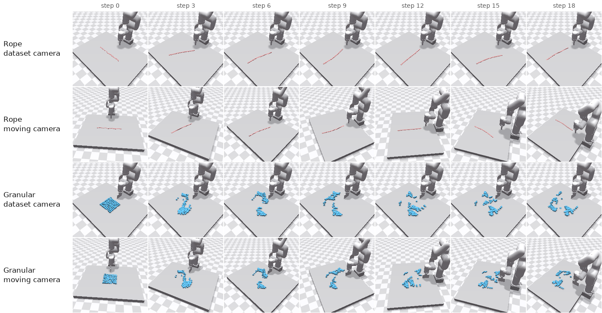
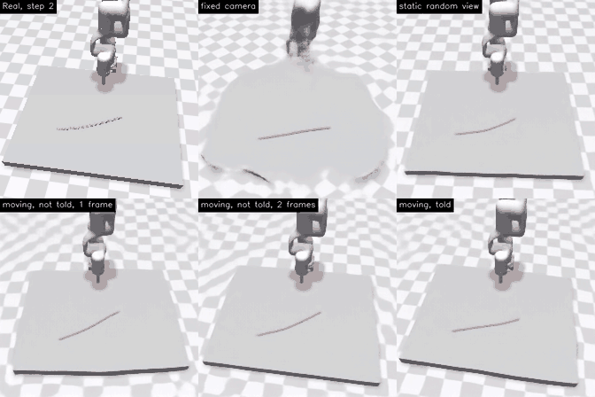
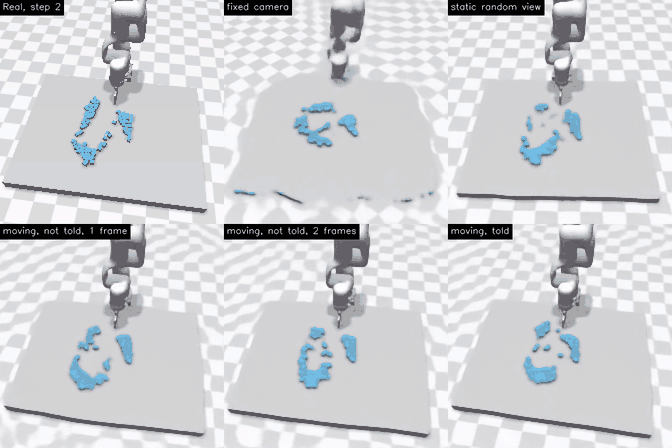

# DINO-WM with a moving camera (Rope, Granular)

Branch `hanbin5/occlusion`, based on [`hanbin5/local`](repro/LOCAL.md).

This branch measures the next-frame prediction error of DINO-WM on Rope and Granular when the camera moves during an episode.



Rows 1 and 3 are rendered from the dataset camera. Rows 2 and 4 are the same episodes rendered from a moving camera. In this example the camera rotates 127° around the table.

## Results

One-step predictions under a moving camera, decoded to pixels. The first panel is the real frame. The other panels are the five models.





The numbers are the MSE between the predicted and the actual DINOv2 features of the next frame. Lower is better. "Copy" uses the current frame as the prediction. All models are at 50 epochs and are evaluated on the 100 validation episodes.

Rope:

| Test camera | Copy | `fixed` | `static` | `move-blind-h1` | `move-blind-h2` | `move-told-h1` |
|---|---|---|---|---|---|---|
| E-fixed | 0.393 | 0.083 | 0.168 | 0.886 | 0.709 | 0.433 |
| E-static | 0.361 | 1.861 | 0.174 | 0.797 | 0.641 | 0.501 |
| E-move | 1.389 | 2.101 | 1.143 | 0.990 | 0.557 | 0.495 |
| E-move-fast | 2.321 | 2.614 | 2.091 | 1.732 | 1.068 | 1.083 |

Granular:

| Test camera | Copy | `fixed` | `static` | `move-blind-h1` | `move-blind-h2` | `move-told-h1` |
|---|---|---|---|---|---|---|
| E-fixed | 0.284 | 0.145 | 0.178 | 0.974 | 0.606 | 0.454 |
| E-static | 0.274 | 1.142 | 0.185 | 0.782 | 0.639 | 0.493 |
| E-move | 1.285 | 1.582 | 1.132 | 1.019 | 0.598 | 0.514 |
| E-move-fast | 2.204 | 2.190 | 2.037 | 1.642 | 1.164 | 1.348 |

E-move, Rope / Granular:

| Model | Predictions closest to the real next frame | Error after 5 open-loop steps |
|---|---|---|
| Copy | | 3.512 / 3.383 |
| `fixed` | 3% / 0% | 3.785 / 3.393 |
| `static` | 0% / 0% | 3.273 / 3.090 |
| `move-blind-h1` | 32% / 30% | 2.765 / 2.727 |
| `move-blind-h2` | 76% / 60% | 1.706 / 1.840 |
| `move-told-h1` | 81% / 64% | 0.969 / 0.904 |

"Closest to the real next frame" compares each prediction with three frames: the real next frame, a frame where the camera moved and the object did not, and a frame where the object moved and the camera did not.

- The `fixed` model has a larger error than copy on E-static and E-move.
- With the camera motion given as input, the error under a moving camera is 0.36 (Rope) and 0.40 (Granular) of the copy error.
- With two context frames and no camera input, the one-step error is 0.557 and 0.598. After 5 open-loop steps it is about twice the error of `move-told-h1`.
- The three models trained with a moving camera have a larger error than copy when the camera is static.

Videos (80 per object, Google Drive): [Rope](https://drive.google.com/drive/folders/1Jw2G-sCRNJEmS_Dzhj0DGh5E-5GVqjyl), [Granular](https://drive.google.com/drive/folders/1iuVgu2i4MLJBcNp3O8Bj-Gy5os3czb-F).

## Setup

| Item | Description |
|---|---|
| Environments | Rope, Granular (NVIDIA FleX) |
| Camera motion | Rotation around the table with changes in height and distance. The velocity is constant within an episode. |
| Data | The dataset stores the particle positions of every frame. Frames are re-rendered from these positions with a different camera. States, actions and the train/validation split are the same as in the original dataset. |
| Details | [PLAN_camera_motion.md](PLAN_camera_motion.md) (Korean) |

Models, per object:

| Name | Training camera | Camera motion given as input | Context frames |
|---|---|---|---|
| `fixed` | dataset camera | - | 1 |
| `static` | random pose per episode, no motion | no | 1 |
| `move-blind-h1` | moving | no | 1 |
| `move-blind-h2` | moving | no | 2 |
| `move-told-h1` | moving | yes, appended to the action | 1 |

`fixed` is the model from the reproduction. The other four are trained on this branch.

Test cameras:

| Name | Camera |
|---|---|
| E-fixed | dataset camera |
| E-static | random pose per episode, no motion |
| E-move | moving, 2 to 8° per step |
| E-move-fast | moving, 10 to 15° per step |

## How to run

Install the environment and the Rope and Granular data as described in [repro/README.md](repro/README.md). Rendering needs PyFleX. Training and evaluation do not.

Render the training sets and the evaluation sets. Repeat with `--object granular`.

```bash
source repro/env.sh
python scripts/render_camera_data.py --object rope --variant static_rand
python scripts/render_camera_data.py --object rope --variant move
for v in fixed static_rand move move_fast; do python scripts/render_camera_data.py --object rope --variant $v --episodes val --counterfactual --name eval_$v; done
```

Train one model. The command below is `move-told-h1`.

```bash
python train.py env=deformable_cam env.dataset.object_name=rope env.kwargs.object_name=rope env.dataset.variant=move env.dataset.cam_action=true frameskip=1 num_hist=1 training.epochs=50 training.save_every_x_epoch=10 ckpt_base_path=$DINO_TRAIN hydra.run.dir=$DINO_TRAIN/outputs/cam_rope_move_told_h1
```

Settings of the four models and GPU memory at batch 32:

| Model | Settings that differ | GPU memory |
|---|---|---|
| `static` | `env.dataset.variant=static_rand num_hist=1 has_decoder=False model.train_decoder=False` | about 4 GB |
| `move-blind-h1` | `env.dataset.variant=move num_hist=1 has_decoder=False model.train_decoder=False` | about 4 GB |
| `move-blind-h2` | `env.dataset.variant=move num_hist=2 has_decoder=False model.train_decoder=False` | about 9 GB |
| `move-told-h1` | `env.dataset.variant=move env.dataset.cam_action=true num_hist=1` (with decoder) | about 12 GB |

The trained models are on Hugging Face in [`hanbin5/dino-wm-camera`](https://huggingface.co/hanbin5/dino-wm-camera) (checkpoints every 10 epochs, `outputs/<model>/checkpoints/model_50.pth` is the one evaluated). `huggingface-cli download hanbin5/dino-wm-camera --local-dir $DINO_TRAIN` puts them where the commands below look for them. The rendered training sets are in the dataset [`hanbin5/dino-wm-deformable-cam`](https://huggingface.co/datasets/hanbin5/dino-wm-deformable-cam). The `fixed` model `train_rope@50` is the 50-epoch checkpoint of the Rope model of the benchmark reproduction and is not uploaded.

Evaluate and make the videos. Evaluation of five models uses about 4 GB of GPU memory.

```bash
python scripts/eval_camera_pred.py --object rope --models fixed=train_rope@50 static=cam_rope_static_h1@50 blind_h1=cam_rope_move_blind_h1@50 blind_h2=cam_rope_move_blind_h2@50 told_h1=cam_rope_move_told_h1@50 --decoder cam_rope_move_told_h1@50 --conds eval_fixed eval_static_rand eval_move eval_move_fast --out $DINO_WORK/results/camera_motion/eval_rope.json
python scripts/make_camera_videos.py --object rope --models fixed=train_rope@50 static=cam_rope_static_h1@50 blind_h1=cam_rope_move_blind_h1@50 blind_h2=cam_rope_move_blind_h2@50 told_h1=cam_rope_move_told_h1@50 --decoder cam_rope_move_told_h1@50 --conds eval_fixed eval_static_rand eval_move eval_move_fast --out $DINO_RUNS/camera_motion/videos/rope
```

## Code

| File | Purpose |
|---|---|
| `env/deformable_env/camera_motion.py` | camera pose and trajectories |
| `scripts/render_camera_data.py` | re-rendering |
| `datasets/deformable_cam_dset.py`, `conf/env/deformable_cam.yaml` | dataset and config for training |
| `scripts/eval_camera_pred.py` | evaluation |
| `scripts/make_camera_videos.py` | videos |

## Other files on this branch

The branch includes the Distracting Reacher code from [thread1 `occlusion0`](https://github.com/jongmin-s-multicore/thread1/tree/occlusion0) by davidjk522. It was merged before this experiment started. The files are `README_experiment.md`, `CLAUDE.md`, `env/distracting_reacher.py`, `scripts/collect_data.py`, `scripts/eval.py`, `scripts/analyze.py` and `scripts/run_all.sh`. Distracting Reacher is a thread1 experiment. It is not part of the experiment on this branch.

---

# DINO-WM reproduction (same as `hanbin5/local`)

This repository is a fork of [gaoyuezhou/dino_wm](https://github.com/gaoyuezhou/dino_wm), the code of DINO-WM ([arXiv:2411.04983](https://arxiv.org/abs/2411.04983), "DINO-WM: World Models on Pre-trained Visual Features enable Zero-shot Planning"). We re-ran the paper's planning benchmarks with the released code. For PointMaze, PushT and Wall we used the authors' released world models. For Rope and Granular we trained the world models ourselves, because no checkpoints were released.

- Evaluation videos: [Google Drive folder `dino-wm-videos`](https://drive.google.com/drive/folders/17M0MZGSDPzu7CCT3ez3ABMyZGjavTfx3). It has four group folders. [`[benchmark]`](https://drive.google.com/drive/folders/1qzPCzAmGGkH3RAtbHiuM1o4GWQTlGXI0) has one sub-folder for each benchmark run listed below. [`[acwm]`](https://drive.google.com/drive/folders/1bxrZo-VIF8ZnbS82kWPGukI-ctp-J4pi) has the ACWM-Phys experiments (branch `hanbin5/acwm-phys`). [`[camera]`](https://drive.google.com/drive/folders/1uAP6EGJESlsj-xNHfOTAo8-o6RLNh0WD) has the moving-camera experiment (branch `hanbin5/occlusion`). [`[data]`](https://drive.google.com/drive/folders/1pAgVNvCbZLKMLwGSiK3Tiukncd1LIiTg) has 10 sample episodes of each training dataset.
- Detailed results and discussion (Korean): issues [#1](https://github.com/jongmin-s-multicore/thread0/issues/1) (PointMaze, PushT, Wall) and [#2](https://github.com/jongmin-s-multicore/thread0/issues/2) (Rope, Granular). Full numbers for the main results table are in the JSON comments of those issues. The additional runs reported below are PointMaze seeds 1 and 101, the original-code-path re-run, the Rope predictor-lr 5e-5 retrain and the Rope/Granular arm-video re-runs. They are not in the issues yet. Their run records are on the `hanbin5/local` branch (`repro/runs/`).
- Protocol (Korean): [repro/SETTINGS.md](repro/SETTINGS.md). It covers models, data, hyper-parameters, evaluation and differences from upstream. How to run (Korean): [repro/README.md](repro/README.md).

## Results

Each row is one sub-folder of [`[benchmark]`](https://drive.google.com/drive/folders/1qzPCzAmGGkH3RAtbHiuM1o4GWQTlGXI0) in the [video folder](https://drive.google.com/drive/folders/17M0MZGSDPzu7CCT3ez3ABMyZGjavTfx3). The planning seed is 99 in every row. Paper numbers are from arXiv v2. MPC numbers are from Table 1. Open-loop CEM and GD numbers are from Table 8.

| Experiment (video folder) | Environment | World model | Planner | Metric | Ours | Paper |
|---|---|---|---|---|---|---|
| [`pointmaze_mpc`](https://drive.google.com/drive/folders/158v3AxloqlmTjQle8--d_khoe-WufC1x) | PointMaze | released | MPC-CEM | success rate, 50 episodes ↑ | **1.00** | 0.98 |
| [`pointmaze_cem30`](https://drive.google.com/drive/folders/1syrPyrz8DvJUqtj0KMOJCGxLqb5_vUJ9) | PointMaze | released | open-loop CEM, 30 opt steps | success rate, 50 episodes ↑ | **0.90** | 0.80 ¹ |
| [`pointmaze_gd`](https://drive.google.com/drive/folders/18LXWuFazAfT0JonZzf79qJVFoJS9TC3o) | PointMaze | released | open-loop GD | success rate, 50 episodes ↑ | **0.20** | 0.22 |
| [`pusht_mpc`](https://drive.google.com/drive/folders/10991WBPOl-Y1ujpCPWMH6cm01HYiuEEF) | PushT | released | MPC-CEM | success rate, 50 episodes ↑ | **0.92** | 0.90 |
| [`pusht_gd`](https://drive.google.com/drive/folders/1q4bBv2dlsNlqEcVhYRjAE8il6mcGtX28) | PushT | released | open-loop GD | success rate, 50 episodes ↑ | **0.56** | 0.28 |
| [`wall_mpc`](https://drive.google.com/drive/folders/1xQaHS_Q6p0j__xbPLCeQz4wrfGnIdl4G) | Wall | released | MPC-CEM | success rate, 50 episodes ↑ | **0.94** | 0.96 |
| [`wall_cem30`](https://drive.google.com/drive/folders/1nezRBUN0DhYKTAR48FHCLnMnBY9Eyp7A) | Wall | released | open-loop CEM, 30 opt steps | success rate, 50 episodes ↑ | **0.28** | 0.74 ¹ |
| [`wall_gd`](https://drive.google.com/drive/folders/1MaVPC-GqGOIfp_qdinaCBVTbWNc2jgM3) | Wall | released | open-loop GD | success rate, 50 episodes ↑ | **0.04** | – (not reported) |
| [`rope_mpc`](https://drive.google.com/drive/folders/1KgGV_Ic2AcpQVooBJCnv4EPqivl_qxbk) | Rope | ours (100 epochs) | MPC-CEM | Chamfer distance, 10 instances ↓ | **0.933** ² | 0.41 |
| [`granular_mpc`](https://drive.google.com/drive/folders/178kKGzYE0xebNJbyfsw1ji9PyrAZUA6C) | Granular | ours (100 epochs) | MPC-CEM | Chamfer distance, 10 instances ↓ | **0.216** ² | 0.26 |

¹ The paper does not state the number of optimization steps used for its open-loop CEM results (Table 8). The one CEM setting it gives is for the planning-time measurement (Appendix A.8: 100 samples, 10 steps). Our open-loop CEM with the MPC configuration's 10 steps is the same computation as MPC iteration 1 (see below). It gives PointMaze 0.86 (paper 0.80) and Wall 0.54 (paper 0.74). With 30 steps, the setting of these folders, PointMaze rises to 0.90 and Wall drops to 0.28. Wall open-loop CEM peaks at 0.58 at 9 optimization steps, and the gap between the world model's predicted latent and the latent of the real outcome grows with more optimization steps (issue #1).
² CD of the original evaluation run. Issue #2 reports these numbers. The videos in these two folders are from a separate re-run that also renders the robot arm (see [How to read the videos](#how-to-read-the-videos)). The final CD of that re-run is 1.045 for Rope and 0.224 for Granular.

Summary. MPC-CEM matches the paper on PointMaze, PushT and Wall. Every gap is 0.02, which is within the binomial standard error of 50 episodes (0.02–0.04 at success rates of 0.90–0.98). Granular reaches the paper's level (CD 0.216 vs 0.26, lower is better). Rope does not reproduce (0.933 vs 0.41). Upstream issue [gaoyuezhou/dino_wm#24](https://github.com/gaoyuezhou/dino_wm/issues/24) reports the same outcome. Open-loop CEM on Wall is below the paper at every number of optimization steps we measured (at most 0.58 vs 0.74). Open-loop GD on PushT is higher than in the paper (0.56 vs 0.28) with the upstream GD config. We did not find the cause.

## What each experiment is

### Environments and tasks

| Environment | Task | Goal of an episode | Success |
|---|---|---|---|
| PointMaze (D4RL U-maze, MuJoCo) | Move a point mass (green dot) through a U-shaped maze | A start and a goal position drawn independently from the free space (`goal_source=random_state`) | Position within 0.5 of the goal position |
| PushT | Push a T-shaped block with a circular agent | Start: a state on a held-out demonstration. Goal: the state 25 env steps later on the same demonstration (`goal_source=dset`). The goal is reachable in 25 steps | Agent and block positions within 20 (4-D L2, 512 px canvas) and block angle within π/9 |
| Wall | Move a dot from one room to the other through a door in a wall | Start and goal in opposite rooms. Wall and door positions are taken from validation trajectories | Position within 4.5 (env units) of the goal |
| Rope (NVIDIA FleX) | Push a rope with an xArm6 pusher | Start: a particle state from a random validation trajectory. Goal: the reset rope shape, translated and rotated | No success test. Upstream's test is false for every episode. The metric is the Chamfer distance |
| Granular (NVIDIA FleX) | Push granular particles with an xArm6 pusher | Start as for Rope. Goal: the reset particle pile, translated and scaled | as Rope |

### World models

- Released (PointMaze, PushT, Wall): checkpoints from the authors' [OSF project](https://osf.io/bmw48/?view_only=a56a296ce3b24cceaf408383a175ce28). Each model consists of frozen DINOv2 ViT-S/14 patch features, a ViT predictor and a VQ-VAE decoder. The decoder is used only for the videos and the prediction-quality metric.
- Ours (Rope, Granular): trained with upstream `train.py` on the OSF datasets for 100 epochs (history 1, frameskip 1, batch 32, upstream default learning rates). See [SETTINGS.md §4.2](repro/SETTINGS.md).

### Planners (upstream `conf/plan*.yaml` and `conf/planner/*.yaml` unless noted)

- MPC-CEM: CEM plans 5 actions ahead (300 samples, top 30). It runs 10 opt steps for PointMaze and Wall, and 30 for PushT, Rope and Granular. All 5 actions are executed in the simulator. The agent then replans from the observation it reached. Upstream has no limit on the number of replanning iterations. We capped them at 20 for PointMaze and Wall, 10 for PushT, and 5 for Rope and Granular. An episode counts as solved once it succeeds after any iteration. This rule is upstream behaviour. PointMaze used 4 iterations, after which all episodes were solved. PushT used 10 and Wall used 20.
- Open-loop CEM: CEM plans the whole horizon (5 actions) once and the plan is executed without feedback. With the MPC settings (10 opt steps for PointMaze and Wall, 30 for PushT), open-loop CEM is the same computation as MPC iteration 1. We compare this setting with the paper's "CEM" column. Ours are PointMaze 0.86, PushT 0.90, Wall 0.54. The paper reports 0.80 / 0.86 / 0.74. The `pointmaze_cem30` and `wall_cem30` folders are the open-loop CEM rows of the results table. They are an extra run with the default of upstream `conf/planner/cem.yaml` (30 opt steps). PushT needs no such run because its MPC setting uses 30.
- Open-loop GD: gradient descent on the action sequence through the world model (upstream `conf/planner/gd.yaml`: SGD lr 1, 1000 steps, noise 0.003).
- The planning objective is the MSE between the world model's predicted final latent and the goal observation's latent. PushT and Wall add a proprioception term. The simulator executes and scores the plan. As in upstream, the planners also read the simulator's success test while planning ([gaoyuezhou/dino_wm#26](https://github.com/gaoyuezhou/dino_wm/issues/26)). CEM and GD stop optimizing once every episode has succeeded. MPC stops replanning an episode once it has succeeded.

### Metrics

- Success rate: fraction of the 50 episodes that pass the success test above. Open-loop planners are scored on the state after the whole plan (5 planned actions = 25 env steps). MPC is scored on the state at the end of the first replanning iteration after which the episode passed, or after the last iteration if it never passed. This scoring is upstream behaviour. An episode that passed once stays counted as a success.
- Chamfer distance (CD): the distance between the final particle positions and the goal particle positions (xyz, sum of the two directional mean nearest-neighbour distances), averaged over the 10 instances. Lower is better.

## How to read the videos

Every folder contains `output_final_<i>_<tag>.mp4` for episodes `i` = 0–9. The episodes are the first 10 of the 50 evaluated episodes, or all 10 instances for Rope and Granular. `<tag>` is `success` or `failure` from the final evaluation. Every Rope and Granular video is tagged `failure`, because upstream's success test for them is false for every episode. The metric for these two environments is CD.

Each frame is a 2 × 2 grid with a label in every panel:

| | left | right |
|---|---|---|
| top | Real: the simulator executing the planned actions | Goal: the goal observation |
| bottom | Model: the world model's prediction for the same actions, decoded to pixels | Goal |

- PointMaze, PushT, Wall: 12 fps, one frame per simulator step. The Model panel changes every 5 frames, once per planned action (frameskip 5). MPC videos show the whole executed trajectory up to the iteration at which the episode succeeded. Every video ends with its last frame shown for 3 s. There are no gray padding frames.
- PushT: the light-green T is drawn by the environment at a fixed pose in every image, including the training data. It is not the goal. The red outline in Real and Model is the goal pose of the block. In these converted videos the outline was fitted to the Goal panel, within 3 px (512 px canvas) and 2° of the true goal pose. New runs draw the outline from the goal state.
- PointMaze: the red ring marks the goal position. Its radius is the success radius 0.5. The ring has four ticks pointing at the goal. Frames show the position one 0.01 s physics sub-step behind the state used for scoring. An episode that ends at the boundary can appear slightly outside the ring. Episode 4 of `pointmaze_mpc` is an example.
- Wall: no overlay. The goal is the dot in the Goal panel.
- Rope, Granular: 24 fps. These videos are from a re-run that keeps the intermediate simulator frames ([`repro/eval/deform_arm_video.py`](repro/eval/deform_arm_video.py)). The xArm is seen pushing in these frames. The data and the standard evaluator keep one frame per push, taken after the arm has returned home. The Model panel advances when each push finishes. The re-run used the same model, settings, seed and start/goal particle states. FleX simulation and rendering are not bit-reproducible across processes. The Rope re-run also ran on the other of our two GPUs, and its rendered start/goal images differ slightly. The Granular re-run matches the evaluated run for two MPC iterations and then diverges. Per-instance results differ from the evaluated run. Final CD is 1.045 vs 0.933 for Rope and 0.224 vs 0.216 for Granular.

The plotted frames, labels and overlays are drawn after the metrics are computed. With the overlay on and off, `logs.json` is byte-identical and the start/goal file (`plan_targets.pkl`) contains the same values. For PointMaze the start/goal file is also byte-identical. For PushT its pickle bytes differ. Old videos were converted with `repro/eval/{pusht_goal_overlay,pointmaze_goal_overlay,reformat_eval_videos}.py`.

## Additional results

The results in this section are not in the video folder.

MPC success rate vs. number of replanning iterations (iteration 1 = open-loop CEM):

| Iterations | 1 | 2 | 3 | 4 | 5–10 | 11–20 |
|---|---|---|---|---|---|---|
| PointMaze | 0.86 | 0.96 | 0.96 | 1.00 | | |
| PushT | 0.90 | 0.92 | 0.92 | 0.92 | 0.92 | (cap 10) |
| Wall | 0.54 | 0.86 | 0.94 | 0.94 | 0.94 | 0.94 |

PointMaze over three seeds (99, 1 and 101), 50 episodes each. Mean success: MPC 0.987 (paper 0.98), open-loop CEM with 10 steps 0.82 (paper 0.80), CEM with 30 steps 0.87, GD 0.25 (paper 0.22). The gaps to the paper are within seed-to-seed variation. Re-running seed 99 with the original code path (original attention, no skipping of solved episodes) gives the same success rates for open-loop CEM at each of the 30 opt steps and for MPC iteration 1 (0.86). The other logged metrics agree to within 3e-4 relative, which is consistent with the ~1e-6 latent difference of fp32 SDPA attention. GD is chaotic and its result changes (0.20 → 0.14).

Rope and Granular, MPC iterations (CD after each iteration, with the actions so far replayed from the start):

| Iteration | 1 | 2 | 3 | 4 | 5 | final evaluation | paper |
|---|---|---|---|---|---|---|---|
| Rope | 1.199 | 1.320 | 0.918 | 0.686 | 0.909 | 0.933 | 0.41 |
| Granular | 0.409 | 0.304 | 0.223 | 0.223 | 0.222 | 0.216 | 0.26 |

The final evaluation replays the same actions as iteration 5 and gives a different CD, because FleX results depend on execution history (issue #2). We also retrained Rope with the predictor learning rate listed in the paper's Table 12, which is 5e-5. Upstream uses 5e-4. Decoded prediction quality improved (LPIPS 0.043 → 0.018, SSIM 0.963 → 0.985). The gain is due to the decoder (reconstruction LPIPS 0.039 → 0.012). The decoder settings were unchanged, and planning does not use the decoder. The predictor's latent prediction loss got slightly worse (0.071 → 0.079). Planning did not improve. CD was 1.157 with the retrained model, and two runs of the 5e-4 model gave 0.933 and 1.045. The learning rate does not explain the Rope gap.

Prediction quality. The metric is VGG LPIPS ↓ / SSIM ↑ of the decoded one-step prediction on the validation split. For PointMaze and Wall it is computed on 5000 evenly spaced slices of 16200 / 7872. Paper numbers are from Table 4 and 9. The comparison is approximate, because the paper does not state its prediction horizon or sample count:

| | PointMaze | PushT | Wall | Rope | Granular |
|---|---|---|---|---|---|
| Ours | 0.0006 / 0.999 | 0.0067 / 0.987 | 0.0022 / 0.997 | 0.043 / 0.963 | 0.102 / 0.901 |
| Paper | – | 0.007 / 0.985 | 0.0016 / 0.997 | 0.009 / 0.985 | 0.035 / 0.94 |

For Rope and Granular, encode–decode reconstruction of the target frame is almost as poor as the prediction. The gap is mostly due to the decoder.

Not reproduced: Reacher, the baselines IRIS / DreamerV3 / TD-MPC2 / AVDC, the generalization environments, and the encoder and ablation studies. The Reacher data and environment were not released. The baselines are not in the codebase. The WallRandom and PushObj datasets were not released, and GranularRandom needs changes to the environment code. The encoder and ablation studies need many retrained models, and the mask and decoder-loss ablations need code changes. See [SETTINGS.md §1](repro/SETTINGS.md).

## Running it

Hardware used: two 24 GB GPUs (RTX 3090 Ti + RTX 3090) on Ubuntu 24.04. Setup scripts and the job queue are in `repro/` ([repro/README.md](repro/README.md), Korean). Run the commands below in one bash or zsh shell, from the repo root. The code blocks contain no `#` comments on purpose. Without `setopt interactivecomments`, zsh passes an inline `# ...` to the command as arguments. This option is off by default, and oh-my-zsh, for example, turns it on.

Requirements:

- An NVIDIA driver, `git curl bzip2 unzip zip gcc`, and `libglew-dev libgl1-mesa-dev` for building mujoco-py. mujoco-py builds its GPU (EGL) renderer if `/usr/lib/nvidia` exists. Ubuntu's driver packages create this directory. Otherwise mujoco-py builds a CPU renderer, which also needs `libosmesa6-dev`.
- For Rope and Granular planning: docker with the NVIDIA container runtime, usable without sudo (`docker` group).
- Disk space in the work root `$DINO_WORK` (default `~/dinowm`): about 110 GB for PointMaze, PushT and Wall (Python env 9 GB, data 91 GB, checkpoints 1 GB, zip files 6 GB), and about 160 GB more for Rope and Granular (data 144 GB, zip files 15 GB, plus a 15 GB temporary file while unzipping). The zip files in `$DINO_WORK/downloads` can be deleted after unzipping. If your home directory is small, choose a work root on a larger disk.

Install:

Nothing assumes your home directory. The commands below clone the repo into the current directory. The repo can be placed anywhere. `DINO_WORK` is the work root for the env, data, checkpoints and run outputs, and can be any path outside the repo. `~/dinowm` in the third line is the default. If your home directory is small, replace it with a path on a larger disk (see the disk space above).

```bash
git clone https://github.com/jongmin-s-multicore/thread0.git
cd thread0
export DINO_WORK=~/dinowm
bash repro/setup/install_env.sh
```

Every script reads `DINO_WORK` from the environment and uses `~/dinowm` if it is not set. If you choose another path, set it again in every new shell (for example in `~/.bashrc`), or write `export DINO_WORK=${DINO_WORK:-/your/path}` into `.claude/env.local.sh` in the repo. This file is gitignored, and `repro/env.sh` reads it first.

`install_env.sh` creates a micromamba env (Python 3.9 with the pinned versions of `environment.yaml`), installs MuJoCo 2.1.0 into `~/.mujoco/mujoco210` and builds mujoco-py. mujoco-py looks for MuJoCo in this directory by default. Set `MUJOCO_DIR` to use another path. The script installs the pip packages (about 4 GB of downloads) with uv if `uv` is on `PATH`, otherwise with pip. `bash repro/setup/install_env.sh --dry-run` prints the commands without running them.

PyFleX is needed for Rope and Granular only. Build it in docker:

```bash
bash repro/setup/install_pyflex.sh
```

Data and released checkpoints are downloaded from the authors' OSF project. `core` is PointMaze, PushT and Wall. `deformable` is Rope and Granular. If a download is interrupted, run the same command again and it resumes.

```bash
bash repro/setup/download_data.sh core checkpoints
bash repro/setup/download_data.sh deformable
```

Check and one quick planning run. `source repro/env.sh` sets the paths and puts the env's `python` first on `PATH`. Run it in every new shell. `check_env.sh` tests torch/CUDA, mujoco-py and DINOv2, then replays dataset actions in PointMaze, PushT and Wall and compares the frames with the dataset. `check_env.sh --pyflex` adds Rope and Granular. The `plan.py` command plans 2 episodes with the released PointMaze model and writes to `$DINO_RUNS/smoke/point_maze`. It takes under a minute.

```bash
source repro/env.sh
bash repro/setup/check_env.sh
python plan.py --config-name plan_point_maze.yaml model_name=point_maze ckpt_base_path=$DINO_CKPT \
  n_evals=2 planner.sub_planner.opt_steps=2 planner.max_iter=1 hydra.run.dir=$DINO_RUNS/smoke/point_maze
```

All benchmark jobs (`repro/jobs/benchmark.txt`) run in a background job queue. The queue log is `$DINO_RUNS/scheduler.log`. GPUs, jobs per GPU and free-memory thresholds are set with environment variables ([repro/README.md](repro/README.md), "머신별 설정").

```bash
bash repro/queue/start.sh
```

What was tested. On 2026-10-09 we ran the commands above on the machine above in bash, with an empty home directory, a clean environment (`env -i`) and pip (no uv on `PATH`). Every step succeeded, including `check_env.sh --pyflex` and the quick planning run. The `core` and `deformable` downloads and the job queue were not repeated in that run. For those two downloads we linked our existing data. The `checkpoints` download, which uses the same downloader, was run. In a separate Ubuntu 24.04 container without `/usr/lib/nvidia`, the mujoco-py build failed without `libosmesa6-dev` and succeeded with it. The PointMaze frames rendered in that container differ from the dataset frames by a mean of 0.03 on the 0–255 scale (0.00 with the GPU renderer). Other Linux distributions and other GPUs are untested.

## Branches and changes to upstream

- `main`: upstream `0a9492f` plus fixes and features that apply to any GPU environment, and the reproduction tooling in `repro/`. Every edited upstream block has a `[repro]` comment. To list the edits, run `git diff 0a9492f -- . ':!repro' ':!*.md' ':!.gitignore'`.
- [`hanbin5/local`](https://github.com/jongmin-s-multicore/thread0/tree/hanbin5/local): `main` plus memory/speed changes for 24 GB GPUs and the run records of the results above (`repro/LOCAL.md`, `repro/runs/`). All results in this README were produced with this branch's code. LOCAL.md §6 maps each job to the commit it ran from. The changes are fp32 SDPA attention, chunked CEM rollouts and GD, decoding only the plotted rollouts, skipping CEM for episodes that MPC has solved, and validation under `no_grad`. With one exception, they keep the computation identical or within 1.4e-6 relative error. The exception is skipping solved episodes, which changes MPC from iteration 2 on. Iteration 1 is identical. With skipping, the remaining episodes draw random numbers in a different order, and the inner CEM's early stop checks the unsolved episodes. Without skipping it checks all 50.

Changes on `main`:

| File | Change | Effect on results |
|---|---|---|
| `models/dino.py` | Pin the DINOv2 torch.hub code to `85a2460` (Python 3.9, upstream issue #25) | none (identical features) |
| `env/deformable_env/.../flex_env.py` | Call `pyflex.init()` once per process, because several envs segfaulted | none |
| `train.py` | Also write epoch metrics to `epoch_logs.jsonl`, for runs without wandb | none |
| `planning/evaluator.py` | Evaluation videos: panel labels, end at the last executed frame, last frame shown for 3 s | videos only |
| `plan.py`, `env/pusht/goal_outline.py` | PushT: outline the goal block pose on plots/videos | plots/videos only (`logs.json` identical) |
| `plan.py`, `env/pointmaze/goal_marker.py` | PointMaze: ring of the success radius at the goal position on plots/videos | plots/videos only (`logs.json` identical) |

Protocol choices that differ from upstream defaults, such as the MPC iteration caps, are listed in [SETTINGS.md §6](repro/SETTINGS.md).

## License

Code is MIT like upstream ([LICENSE](LICENSE), © gaoyuezhou). `repro/` and our changes are MIT as well. Datasets and released checkpoints are from the authors' [OSF project](https://osf.io/bmw48/?view_only=a56a296ce3b24cceaf408383a175ce28) and are not redistributed here. Our trained weights are not redistributed either. The upstream README is kept as [README_upstream.md](README_upstream.md). Repository conventions are in [AGENTS.md](AGENTS.md) (Korean).
