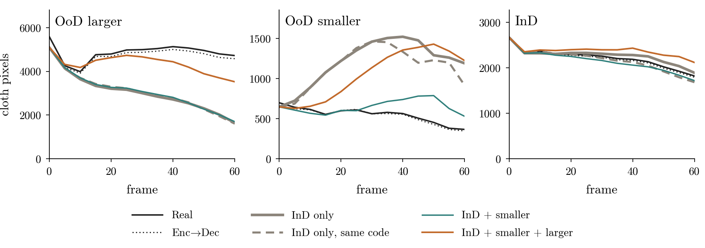

# Cloth Move: smaller + InD 천으로 학습하고 larger 천 예측하기

OoD 섞기 (`../README.md`) 에서 larger 를 뺀 실험이다. predictor 를 InD 와 OoD smaller 25 episode 로 학습하고, 학습에 넣지 않은 larger 를 첫 실제 프레임과 action 으로 예측시킨다. larger 는 학습한 크기 범위 (0.26배 – 1배) 의 바깥에 있다.



천 픽셀 수의 rollout 곡선이다 (episode 평균). 평가한 episode 는 모든 모델에게 학습에 없던 것이다.

## Models

| Name | Training episodes | Code, precision | Model dir |
|---|---|---|---|
| orig | InD 1,800 | `train.py`, fp32 | `train_cloth_h1f5` |
| ctrl | InD 1,800 | `predictor_long.py`, TF32 + bf16 | `train_cloth_h1f5_indctl` |
| small | InD 1,800 + smaller 25 | `predictor_long.py`, TF32 + bf16 | `train_cloth_h1f5_oodsmall` |
| prev | InD 1,800 + smaller 25 + larger 25 | `predictor_long.py`, TF32 + bf16 | `train_cloth_h1f5_oodmix` |

- 학습에 넣은 OoD episode 는 번호가 짝수인 것이다. 평가는 홀수 25 + 25 episode (네 모델 모두에게 학습에 없던 것) 와 larger 전체 50 (orig, ctrl, small) 에서 한다.
- ctrl 은 small 과 같은 코드와 정밀도로 InD 만 학습한 대조군이다.
- 네 모델의 encoder 와 decoder 는 같다 (`train_cloth_h1f5`).
- DINOv2 token 을 GPU 에 올려서 학습 중 GPU 메모리가 약 23 GB 필요하다. 모자라면 `--tokens_cpu` 를 붙인다 (RAM 약 19 GB).

## Files

| File | Content |
|---|---|
| `curves.py` | 네 모델을 같은 episode 에서 rollout, ahead1, ahead5 로 예측해 `curves.npz` 에 저장한다 |
| `analyze.py` | `curves.npz` 에서 `tables.md` 와 `small_only.json` 을 만든다 (마지막 프레임 천 픽셀, retention r(k), 모델 쌍의 차이와 bootstrap 95 % 구간) |
| `make_fig.py` | 곡선 그림 |

retention r(k) 는 (OoD 그룹 평균 − InD 평균) 의 예측 천 픽셀을 같은 차이의 Enc→Dec 픽셀로 나눈 값이다. 1 이면 OoD 크기 차이가 유지되고 0 이면 InD 와 같다.

## Reproduce

레포 루트에서 `source repro/env.sh` 한 뒤 실행한다. `train_cloth_h1f5` (원래 모델) 와 `train_cloth_h1f5_oodmix` (이전 OoD 섞기) 는 `$DINO_TRAIN/outputs` 에 있어야 한다 (Hugging Face [`hanbin5/dino-wm-acwm-phys`](https://huggingface.co/hanbin5/dino-wm-acwm-phys)).

```bash
python repro/colab/ckpt_tools.py slim $DINO_TRAIN train_cloth_h1f5 cloth_slim.pt
python repro/colab/predictor_long.py cloth_slim.pt $DATASET_DIR/acwm_phys out_small --extra_split ood_test --extra_train smaller:even --workers 8 --tf32 --amp --epochs 5,10,15 --from_scratch --tag oodsmall
python repro/colab/predictor_long.py cloth_slim.pt $DATASET_DIR/acwm_phys out_ctrl --extra_split ood_test --extra_train smaller:none,larger:none --workers 8 --tf32 --amp --epochs 5,10,15 --from_scratch --tag indctl
python repro/colab/ckpt_tools.py merge $DINO_TRAIN train_cloth_h1f5 out_small/train_cloth_h1f5_oodsmall_ep15.pt train_cloth_h1f5_oodsmall
python repro/colab/ckpt_tools.py merge $DINO_TRAIN train_cloth_h1f5 out_ctrl/train_cloth_h1f5_indctl_ep15.pt train_cloth_h1f5_indctl
CUDA_VISIBLE_DEVICES=0 python repro/eval/acwm_followup/ood_small/curves.py curves.npz
python3 repro/eval/acwm_followup/ood_small/analyze.py curves.npz .
python3 repro/eval/acwm_followup/ood_small/make_fig.py small_only.json fig_curves.png
```

`predictor_long.py` 는 학습에 넣은 episode 와 남긴 episode 를 `<out>/<model>_split.json` 에 쓴다. 마지막 프레임 평가 (`repro/eval/trend_acwm_phys.py ... --held_out <split.json>`) 도 같은 episode 를 쓴다.
